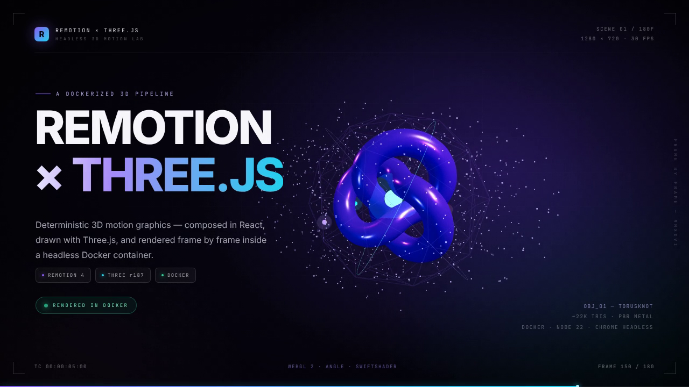

# Remotion × Three.js × Docker

一个可以直接运行的 **Remotion + Three.js** 3D 动态标题项目，整套渲染链路封装在 Docker 镜像里：**不需要 GPU，不需要在宿主机安装 Chrome、Node 或 ffmpeg**，`docker compose run --rm --build render` 就能在容器内渲染出 MP4。

示例成片：`out/remotion-three-hero.mp4`（1280×720 / 30fps / 6 秒 / H.264）。

[观看成片](docs/demo.mp4)（6 秒 / 1.6 MB）



https://www.remotion.dev · https://threejs.org

---

## 这个项目做了什么

- **Remotion** 负责时间轴：所有动画都是 `frame` 的纯函数，逐帧渲染，结果可复现。
- **React Three Fiber + Three.js** 绘制 3D 场景：金属质感环面纽结、发光核心、轨道环、粒子星空、移动灯光。
- **Docker** 负责环境：Chrome Headless Shell、字体、GL 软件栈全部预装在镜像里。
- **无 GPU 的 WebGL**：使用 Chrome 自带的 ANGLE + SwiftShader 做 CPU 软件渲染，在普通服务器/CI 里也能出图。

```
Remotion frame ──► React (DOM 排版 + 文字动效)
                └─► @remotion/three <ThreeCanvas> ──► WebGL (SwiftShader)
                                                     │
                Chrome Headless Shell ◄──────────────┘
                          │
                   H.264 (ffmpeg, 内置)
                          │
                  out/remotion-three-hero.mp4
```

## 快速开始

要求：Docker（带 Compose 插件）。首次构建需要联网下载 npm 依赖和 Chrome Headless Shell（约 1–2 分钟，取决于网络）。

```bash
# 构建并渲染，成片落在 ./out
docker compose run --rm --build render
```

等价的原始命令：

```bash
docker build -t remotion-three-docker .
docker run --rm -v "$PWD/out:/app/out" remotion-three-docker
```

输出：`out/remotion-three-hero.mp4`。

在 2 核、无 GPU 的容器中，本示例实测：打包约 15 秒，180 帧渲染约 42 秒（SwiftShader 软件渲染）。

### 渲染单帧 PNG（调试画面最方便）

```bash
docker run --rm -v "$PWD/out:/app/out" remotion-three-docker \
  node render.mjs --still --frame 96 --out out/frame-096.png
```

渲染脚本参数：

| 参数 | 默认值 | 说明 |
| --- | --- | --- |
| `--still` | off | 只渲染一张 PNG |
| `--frame` | `96` | 静帧帧号（配合 `--still`） |
| `--out` | `out/remotion-three-hero.mp4` | 输出路径 |
| `--composition` | `Hero` | 合成 ID |
| `--gl` | `swangle` | `angle` / `swangle` / `swiftshader` / `egl` / `vulkan` |
| `--concurrency` | `2` | 并行渲染的标签页数量（软件渲染下建议 1–2） |

也可以通过环境变量控制：`REMOTION_GL`、`REMOTION_CONCURRENCY`。

### 在 Docker 里跑 Remotion Studio

```bash
docker compose --profile tools up studio
# 打开 http://localhost:3000
```

`src/` 和 `public/` 以 bind mount 方式挂载，改代码会热更新。

## 本地开发（可选）

```bash
npm install
npx remotion studio src/index.ts   # 交互式预览
npm run render                     # 需要本机有 Chrome Headless Shell
npx tsc --noEmit                   # 类型检查
```

首次本地渲染前执行 `npx remotion browser ensure` 下载 Chrome Headless Shell。

## 项目结构

```
.
├── Dockerfile              # Node 22 + Chrome 依赖 + Chrome Headless Shell
├── docker-compose.yml      # render / still / studio 三个服务
├── Makefile                # 常用命令快捷方式
├── render.mjs              # bundle → selectComposition → renderMedia 脚本
├── remotion.config.ts      # 默认 GL 后端 = swangle
├── public/fonts/           # 内嵌 Inter / JetBrains Mono，避免容器无字体
├── src/
│   ├── index.ts            # registerRoot
│   ├── Root.tsx            # 合成配置：Hero / 1280×720 / 30fps / 180 帧
│   ├── Hero.tsx            # 版式、文字动效、HUD、进度条、背景
│   └── ThreeScene.tsx      # Three.js 场景（环面纽结 / 粒子 / 灯光 / 相机）
└── out/                    # 渲染产物
```

## 实现要点

### 1. 确定性动画

- 文字动画全部由 `spring()` / `interpolate()` 从当前帧计算。
- 3D 旋转、相机漂移、粒子分布都不使用 `Math.random()`；粒子用固定种子的 `mulberry32` 伪随机数生成。
- `<ThreeCanvas>` 在渲染模式下把 R3F 的 `frameloop` 设为 `never`，由 Remotion 的当前帧驱动 `advance()`，所以不会出现「渲染时快时慢」导致的不同步。

### 2. 没有 GPU 也能渲染 WebGL

Remotion 4 需要显式开启 GL 后端，项目在两处做了设置：

```ts
// render.mjs
chromiumOptions: { gl: "swangle", enableMultiProcessOnLinux: true }
```

```ts
// remotion.config.ts（Studio / CLI）
Config.setChromiumOpenGlRenderer("swangle");
```

`swangle` 会把 Chrome 的 GL 实现切到 `--use-gl=angle --use-angle=swiftshader`，也就是 Chrome 内置的 SwiftShader（Vulkan）软件渲染。单独使用 `angle` 时，Remotion 4 只传 `--use-gl=angle`，在无 GPU 的容器里可能无法创建上下文，所以这里默认改成 `swangle`。镜像中安装了 `libgl1`、`libegl1`、`libvulkan1` 等共享库，因此不需要 `--gpus`、不需要 Xvfb，也不需要 Mesa 驱动。

### 3. 字体

容器一般没有可用字体；项目把 Inter 和 JetBrains Mono 的 woff2 放进 `public/fonts`，用 `@font-face` + `delayRender()` 等字体加载完成后再截图，避免首帧文字闪烁或豆腐块。

### 4. 容器构建顺序

`package.json` / `package-lock.json` → `npm ci` → `npx remotion browser ensure` 都放在源码 COPY 之前。改 `src/` 时只会重建最后的源码层，迭代渲染很快。

## 自定义

- **时长 / 分辨率 / 帧率**：改 `src/Root.tsx` 里的 `durationInFrames`、`width`、`height`、`fps`。
- **配色**：`src/Hero.tsx` 顶部的 `VIOLET` / `CYAN` / `GREEN`，以及渐变文字和背景 `radial-gradient`。
- **3D 物体**：`src/ThreeScene.tsx`，替换 `torusKnotGeometry`、材质、灯光、粒子数量即可。
- **文案**：`src/Hero.tsx` 中的标题、副标题、chips。

渲染参数里 3D 的像素成本主要在抗锯齿和片元着色。软件渲染想更快，可以先把 `ThreeCanvas` 的 `antialias` 关掉，或把 `dpr` 固定为 1（当前已经是 1）。

## 故障排查

**`Failed to launch the browser process`**
镜像里已包含 Chrome 依赖；如果是自定义镜像，请对照 `Dockerfile` 的 `apt-get install` 列表补齐，并给容器加 `--shm-size=1gb`。

**画面全黑 / WebGL 报错**
先确认 `REMOTION_GL=swangle`。如果仍失败，可以改用 `swiftshader` 或 `egl` 重试：

```bash
docker run --rm -e REMOTION_GL=swiftshader -v "$PWD/out:/app/out" remotion-three-docker \
  node render.mjs --still --frame 96 --out out/test.png
```

**渲染很慢**
SwiftShader 是纯 CPU 渲染。这个 720p/6 秒的示例在 2 核容器里也能完成；1080p 或更复杂的材质会明显变慢，可以降低分辨率、关闭抗锯齿，或把 `REMOTION_CONCURRENCY` 调到 1 避免 CPU 争抢。

**字体变成方块**
确认 `public/fonts/` 下两个 woff2 文件存在；镜像构建时会一起 COPY 进去。
